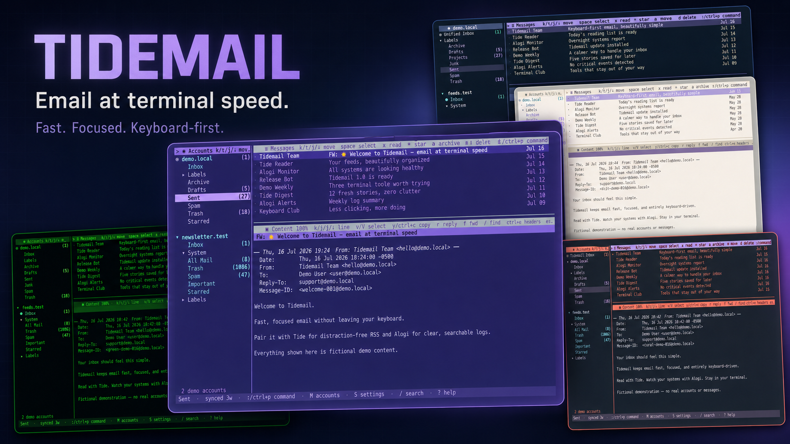
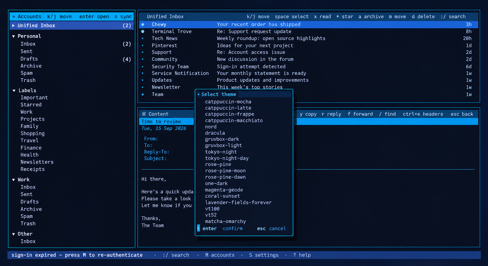

<p align="center"></p>

# TideMail

**Mail for people who live in a terminal.**

[](https://cli.masoko.net/tools/tidemail/)
[](https://github.com/allisonhere/tidemail/releases/latest)
[](LICENSE)
[](https://github.com/allisonhere/tidemail/stargazers)
[](https://github.com/sponsors/allisonhere)

TideMail keeps your accounts, message list, and reading pane on one screen. It
speaks IMAP and SMTP, stores its cache on your machine, and gives the keyboard
the good seat.


[Watch the 40-second intro video](https://mylivelab.com/assets/videos/tidemail-intro-web.mp4)

Need the full settings and shortcut reference? Open the
[setup and usage guide](docs/guide.md).

For shell scripts and AI agents, see the [CLI reference](docs/cli.md).
 TideMail's
headless commands use your configured accounts and persistent queue to list,
search, and read cached mail, draft and send with Markdown or attachments, and
process the outbox:

```bash
tidemail messages list --unread --json
tidemail draft create --to me@example.com --subject "Draft" --body-file message.md
tidemail send --to me@example.com --subject "Hello" --body "Hello" --yes
tidemail outbox process --json
tidemail install-skill codex
```

`install-skill` packages a portable agent skill for Codex, Claude, Pi, or
Hermes, so an AI agent can read, draft, and send through TideMail without
touching your IMAP/SMTP credentials directly. Agent capabilities and an
invocation-approval step separate reading, drafting, and sending, so a script
or agent only gets as much access as you grant it.

For guided CLI workflows, run `tidemail cli` for the command menu or
`tidemail send` for the step-by-step composer and attachment browser, with
Ripple key hints, an attachment browser, a review step, and undo.
[Interactive CLI help](docs/cli.md#interactive-command-menu-and-composer) covers
keyboard navigation and script-friendly prompt controls. **Settings → CLI**
has switches for quitting after a send, skipping review, and the default signature.

`send` saves a draft unless you authorize delivery. `--yes` queues mail with the
configured delay. The client or `outbox process` delivers due queued mail.

An Android app is in beta; you can
[apply to join the beta](https://mylivelab.com/tide/tidemail-android/beta/login.php#apply).
It is developed in a separate repository, and desktop releases are built from
this one.



One inbox, 51 built-in themes in 23 families — Catppuccin, Tokyo Night, Rosé Pine, Gruvbox, Nord, Solarized and more, with their variants ([the list](docs/themes.md)). 

## Highlights

- **NO config file editing, all in the GUI.**
- **One view for every account.** Read a unified inbox or open any account,
  folder, or label from the same three-pane screen.
- **Send from the right address.** Pick an account from the compose From row.
  TideMail switches its SMTP settings, Drafts folder, From address, and
  signature with it.
- **Mail state stays in sync.** Read state, stars, archive, move, and delete use
  IMAP. Changes made in Gmail or another client return to TideMail on sync.
- **A few seconds to change your mind.** Press `Ctrl+Z` to stop a queued send or
  undo a pending delete, archive, or move.
- **An outbox you can trust.** Press `O` to inspect queued, sending, failed, and
  sent mail. Failed deliveries survive restarts and can be retried or edited.
- **Unsubscribe without hunting for a footer.** Press `Ctrl+U` while reading to
  use the message's unsubscribe header or labeled unsubscribe link.
- **Compose your way.** The standard editor supports text selection, the system
  clipboard, undo and redo, and word movement. You can switch on Vim motions
  and commands instead. Optional AI tools can summarize mail, proofread a
  draft, and build local filters from plain English. An optional offline spell
  check (**Settings → Editor**, off by default, in English or Español) underlines
  misspelled words and steps through fixes with `F7`, with no AI provider needed.
  `F6` opens canned replies (six built-ins, plus any `.md` or `.txt` files in
  `~/.config/tidemail/templates`) with the recipient's name filled in; see
  [Templates](docs/guide.md#templates).
- **See the pictures, not just the alt text.** 
  On Ghostty, Kitty, and Rio, images in HTML mail render inline in the reading
  pane, sized to fit and loaded in the background so browsing stays quick.
  Remote images wait until
  you press `i`. Receipts keep their columns and newsletter cards stay
  together.
- **Readable by design, in every theme.** Text, selection highlights, and the
  focused-pane border are all checked against WCAG-style contrast minimums
  (4.5:1 for text, 3:1+ for large text and UI elements like borders) across
  every built-in theme, enforced by automated tests.
- **Match your desktop.** On [Omarchy](https://omarchy.org), the `match-omarchy`
  theme follows your current desktop theme — contrast-corrected to the same
  bar as the built-ins — and repaints live when you switch it.
- **[Experimental plugins](docs/plugins.md).** 
  Install trusted plugins such as TideMail Smart (JEV) to classify mail with
  local annotations, Needs You signals, and optional TypeSafe/Jev analysis.
- **PGP, through a plugin.** 
  Install the `pgp` plugin from **Settings → Plugins → `b`** (it uses your own GnuPG) to read encrypted
  and signed mail (`D`) and to sign (`Alt+S`) and encrypt (`Alt+E`) what you send.
  Nothing is sent if encryption fails, and every recipient needs a public key in
  your keyring (`gpg --locate-keys ADDRESS`). See
  [PGP encryption and signing](docs/guide.md#pgp-encryption-and-signing).
- **Script it, or hand it to an agent.** 
  The `tidemail` CLI shares the client's accounts and queue: list, search, and
  read cached mail, and draft or send with JSON output for scripts, or run
  `tidemail cli` for a guided compose wizard with attachment browsing, review,
  and undo. Portable skills for Codex, Claude, Pi, and Hermes let an agent send
  mail within capabilities and approval you configure. See the
  [CLI reference](docs/cli.md).
- **Prefer the mouse?** 
  Turn on **Settings → Display → Mouse support** (off by default, so your
  terminal's native text selection keeps working). Then click rows and panes,
  double-click a message to open it, use the scroll wheel over any pane, and
  right-click a folder, account, or message for a menu of just its actions.
- **Optional support, kept out of your way.** Open **Settings → Support** to
  visit or copy Tidemail's GitHub Sponsors link; **About** and **Support** are small
  animated scenes. No donation prompts appear during normal email use.

## Install

Linux and macOS builds are available for Intel and ARM machines. Windows
builds are experimental; see [Windows](#windows-experimental) below.

### Arch Linux

TideMail is on the AUR as [`tidemail-bin`](https://aur.archlinux.org/packages/tidemail-bin),
which packages the official release binary along with the TideMail icon and a
desktop entry, so TideMail shows up in your app launcher (it opens in your
default terminal):

```bash
yay -S tidemail-bin
# or
paru -S tidemail-bin
```

Updates come from your AUR helper — `yay -Syu` or `paru -Syu` alongside
everything else, or `yay -S tidemail-bin` for just this one. Plain
`pacman -Syu` will not do it: pacman skips packages it did not install from a
sync repo, so it reports success and leaves TideMail where it was. TideMail
notices it was installed this way and points you at the right command instead
of trying to replace a root-owned binary itself.

### Everywhere else

```bash
curl -fsSL https://raw.githubusercontent.com/allisonhere/tidemail/main/install.sh | sh
```

The installer writes to `~/.local/bin` by default, so it should not ask for a
system password. Set `INSTALL_DIR=/path/to/bin` on the `sh` command if you want
a different writable destination. If an older `tidemail` earlier on `PATH`
would still run first, the installer removes it when possible or prints the
exact cleanup command.

The installer also puts a manual page in `~/.local/share/man/man1`, so
`man tidemail` works. The page is built into the program: if you installed some
other way, `tidemail man | man -l -` shows it, and `tidemail man > tidemail.1`
saves it for you to install.

You can also grab an archive from the
[latest release](https://github.com/allisonhere/tidemail/releases/latest).

### Windows (experimental)

Download `tidemail-windows-x86_64.zip` (or `-aarch64` for ARM) from the
[latest release](https://github.com/allisonhere/tidemail/releases/latest),
unzip it, and run `tidemail.exe` from Windows Terminal or PowerShell. Things to
know:

- In-app updates are not available; download each new release by hand.
- There is no system keychain support yet, so passwords and tokens are saved in
  plain text in `%USERPROFILE%\.config\tidemail\config.toml`.
- Windows is less tested than Linux and macOS. Please report anything that
  misbehaves.

## One screen, three useful panes

The left pane holds accounts and folders. The upper-right pane shows the current
message list. The reading pane stays below it, so opening a message never hides
the rest of your inbox.



Use `j` and `k` to move. Press `Tab` to cross panes. Hit `?` whenever you forget
a key. TideMail keeps the help screen inside the app and lets you search it.

## A normal day in TideMail

- Folders show as a tree. In the left pane press `n` to create a folder, `r` to
  rename and `d` to delete the selected one, `H` to hide it locally, and
  `Shift+K` / `Shift+J` to walk it up or down the tree: reorder it, move it into an open folder, or out of its parent; `>` nests it under the folder above (even an empty one) and `<` moves it back out. `Enter` or `←` / `→` collapse and expand
  folders that have subfolders.
  On servers without a folder hierarchy, names stay literal and flat: `n`
  creates at the account root, and nesting is unavailable.
- Rest on a folder to refresh a stale cache silently, press `Enter` or `s` to
  fetch it immediately, or press `F` to sync every folder.
- Mark messages with `Space`, then archive, move, delete, or change read state as
  a group.
- Press `/` to search the local message cache across accounts.
- Use `*` for a server-backed star. The next sync picks up star changes from
  Gmail and other clients.
- Open a message and press `r` to reply, `Ctrl+R` to reply all, `f` to forward, or `Ctrl+U` to use its
  unsubscribe header.

Delete, archive, and move wait six seconds before TideMail sends them to the
server. `Ctrl+Z` restores the last queued action.

## Compose with the right account

The From row becomes an account picker when you have more than one sender.
TideMail uses the chosen account for SMTP, drafts, the From address, and its
signature. Replies, forwards, and reopened drafts use the same picker.

A standalone `⁂` in the compose body marks where the selected account's signature
will be added when sending, before quoted text by default. Move it to change the
position, or delete it to send unsigned. Drafts preserve it; drafts without a
marker, including older drafts, send without an added signature.

To, CC, and BCC suggest saved contacts first. TideMail follows with addresses
found in mail you have synced. You can manage contacts in the app and move them
through vCard files.

TideMail saves the draft while you type. A sent message waits five seconds by
default, which gives `Ctrl+Z` time to reopen it. Set the delay to `0` if you want
mail to leave at once. Failed sends retry up to three total attempts by default;
change the limit under Settings → Editor. Set it to `1` to disable retries.

The standard compose editor supports Shift-selection, clipboard shortcuts,
undo and redo, word movement, and Home/End. Turn Vim mode on in Settings if you
prefer commands such as `dw`, `dd`, `:w`, and `:q`.

## Mail state belongs to the server

Read state, stars, archive, move, and delete sync through IMAP. TideMail keeps a
local SQLite cache for speed and search, then reconciles it with the server on
sync. By default an account uses IMAP IDLE, so mail lands as the server
announces it (`sync_minutes = 0`); interval polling stays available for servers
that need it, and `-1` keeps an account manual-only.

Drafts live under the selected sender account. Sent messages use that account's
SMTP settings and are filed in its server-side Sent folder; Gmail's own SMTP
filing is detected so it does not receive a duplicate. TideMail detects common
Sent, Archive, and Trash folder names, including Gmail labels.

## Search, links, and attachments

Global search stays active while you move through results. The content pane can
find text inside the open message, walk links, copy a visual selection, and save
attachments to a folder you choose.

Receipts keep item descriptions, quantities, and amounts in aligned columns,
including totals with merged cells. Narrow reading panes show labelled records
instead, so prices stay associated with their items.

Newsletter cards stay together — each image next to its heading, description,
and button — with a thin rule between neighbouring cards.

TideMail renders HTML mail as terminal text. On terminals with Kitty graphics support
(Ghostty, Kitty, Rio), images embedded in the message — CID parts, inline data
URIs, and content-location references — are drawn as real raster images inline in
the reading pane, scrolling with the document. They fit the pane and the sender's
width and height without being stretched or enlarged, and are laid out again when
you change the terminal font size. Images load in the background once you stop on
a message, so moving through the list stays quick. Remote images
stay blocked for privacy until you press `i`, which loads them for the message you
are reading; `[display] images = "off"` forces text placeholders everywhere. On
terminals without graphics support every image becomes a labelled text placeholder.

Choose **Settings → Display → Reading → Images** (`Auto` or `Off`) and press
`Ctrl+S` to save. The change takes effect immediately; remote images still require
`i` to load. The setting also shows whether inline images are supported.

**foot and WezTerm: inline images are currently unsupported.** TideMail uses
text placeholders there. foot supports Sixel images, but TideMail's renderer
requires Kitty Unicode placeholders; WezTerm does not support those placeholders.
Email text and attachment saving still work.

Full headers are one `Ctrl+E` away, with SPF, DKIM, and DMARC results called out
in color. `Ctrl+O` shows the complete message source, ready to copy.

## Thunderbird / IMAP tags

Press `e` to correct a message's classification. The Category choices include
Important, Work, Personal, To Do, and Later. Selecting one with `Enter` also saves
its Thunderbird-compatible tag to the mail server. Checked choices are already
saved; `Space` toggles a tag without removing other assignments. Existing custom
tags appear in the same choices after sync. Changes require a connection and
server support. AI/JEV does not publish tags automatically.

Find tags by keyword or name with `#tag`, including `#"To Do"`. Custom names and
colors are local to each client; edit discovered tags in **Settings → Display →
Tag names and colors**. Choose **Tag icons** under **Tag style** for colored,
Thunderbird-like tag glyphs, with `#` when icons are disabled. Existing appearance
settings stay unchanged. Tags also appear below the date and sender in the
content pane; use **Show tags in message header** under **Settings → Display →
Message tags** to hide that row only. See the [user guide](docs/guide.md#thunderbird--imap-mail-tags).

With **Focus line** on, Up/Down moves the reading highlight. With it off,
Up/Down scrolls one row. At the bottom, another Down selects the first LINKS
entry. Arrows then move between entries without wrapping; Up from the first
clears selection, and the next Up resumes scrolling. Selected LINKS entries
keep their highlight and chevron in both modes.

`o` or `Enter` opens a selected LINKS entry or a visible link deliberately focused
with the keyboard. New messages start with no link selected. Clicking a LINKS
entry selects it without opening it; ordinary body clicks and scrolling never
open links. `Ctrl+B` views the whole message in your browser. These actions use
**Browser command** from Settings → Display when one is set.

View in Browser (`Ctrl+B`) works from the message list or reading pane. It fetches
the original message without marking it read and opens its HTML as a private local
`.html` file in your browser: the **Browser command** from Settings → Display when
one is set, otherwise the system default (`xdg-open` on Linux). Messages without
HTML show a status message. Links are preserved. Remote content is blocked so
opening a message does not load tracking pixels: remote images, scripts, frames,
stylesheets, and web fonts are left out, and the status line reports how many
remote images were dropped. Press `Ctrl+B` again right away to reopen the message
with remote images loaded; this tells the sender the message was opened, so it only
happens when you ask. Embedded CID images are not exported. Exports are
written to a private per-user folder in the system temporary directory and
deleted automatically after an hour (older ones are also pruned when TideMail
starts).

With **Actionable links** enabled, the reader's **LINKS** section uses anchor text
or image descriptions. `Ctrl+N` / `Alt+N` and `Alt+P` move the visible selection
and scroll it into view. The first Next selects the first entry; the first Previous
selects the last. `o` or `Enter` opens the selected destination; `Ctrl+C` on a LINKS
row copies its full URL when no text selection is active. Email actions appear
as `[mailto: description]` and open TideMail's composer using the source message's
account, including in Unified Inbox. Your default sender is the fallback if that
account is unavailable. Recipients, subject, and body can be prefilled; your
signature is inserted at the `⁂` marker when you send. Nothing is sent until you
choose to send.
Each entry shows its real destination host in parentheses, and a
label that names a different site than the link goes to is marked with `!`, so a label
cannot hide where a link leads. HTML resource and metadata URLs are excluded from LINKS, as are links that
only wrap a hidden or 1x1 tracking pixel.

## Optional AI tools

Connect OpenAI, Claude, Gemini, or a local Ollama server if you want message
summaries and a compose proofread. TideMail can also turn a plain-language mail
rule into a local filter that runs without an AI call for each message.

AI stays off until you configure a provider.

## Experimental plugins

TideMail can run external plugins from
`$XDG_CONFIG_HOME/tidemail/plugins/` (or `~/.config/tidemail/plugins/` when
`XDG_CONFIG_HOME` is unset). Plugins
receive message metadata, never message bodies, and can add annotations such as
`needs_reply=true` or `category=shipping`. TideMail uses those annotations for
tags and views such as **Needs You**, while keeping the original plugin output
inspectable. Press `e` on a message to correct its classification locally; plugin reruns
do not erase your correction. Result cards can offer `u` when TideMail itself
finds an unsubscribe option; the plugin never receives the link, and TideMail still
shows its normal confirmation before acting. Report plugins (press `enter` on one in **Plugins
(experimental)**) can ask TideMail read-only questions, such as message volume
or category totals, and show the answer; they never see message bodies or get
database access.

Administer installed plugins directly in **Settings → Plugins**. Select a
plugin and press `s` to edit its settings in the right-hand pane.

To install one, open **Settings → Plugins** and press `b` to browse the
official [TideMail plugin collection](https://github.com/allisonhere/tidemail-plugins):
`i` installs, `u` updates, `x` removes. TideMail shows the permissions first and
checks the download's checksum. You can also copy a plugin's binary and
`plugin.toml` into the plugins directory by hand.
The full user guide is in [docs/guide.md](docs/guide.md#plugins-experimental).

If you are writing a plugin, start with the
[Plugin API getting-started guide](docs/plugins/getting-started.md), then see
[the developer tools guide](docs/plugins/developer-tools.md) for the
`scaffold → build → validate → test` workflow, and see
the [protocol](docs/plugins/protocol.md), [manifest](docs/plugins/manifest.md),
and [permissions](docs/plugins/permissions.md) references. Reports and
read-only queries are covered in [queries](docs/plugins/queries.md) and
[analytics](docs/plugins/analytics.md). Complete local examples are in
[examples/plugins/example](examples/plugins/example/) and
[examples/plugins/analytics](examples/plugins/analytics/). The
[PGP plugin](https://github.com/allisonhere/tidemail-plugins/tree/main/plugins/pgp)
shows the `message_raw` and `message_compose` permissions.

## Keys worth learning

| Key | Action |
|---|---|
| `j` / `k` | Move down or up |
| `Tab` / `Shift+Tab` | Move between panes or compose fields |
| `Up` / `Down` (compose headers) | Move between From, To, Cc, Bcc, and Subject |
| `Enter` | Open a message, immediately sync a folder, or open a draft or picker |
| `c` | Compose |
| `r` / `f` | Reply or forward from the reading pane |
| `Space` | Select a message for a bulk action |
| `a` / `m` / `d` | Archive, move, or delete |
| `x` | Toggle read state for selected messages |
| `*` | Toggle the IMAP star |
| `/` | Search messages |
| `Ctrl+Z` | Cancel a queued send or undo a queued message action |
| `O` | Open the Outbox |
| `Ctrl+U` | Unsubscribe while reading; cycle sender while composing |
| `Alt+F` / `Ctrl+R` | Attach a file while composing; remove the last attachment |
| `Ctrl+D` | Save attachments from the open message |
| `Ctrl+E` | Show or hide full headers |
| `Ctrl+O` | View the message source (`c` copies it) |
| `Ctrl+B` | View the whole message in your browser (remote content blocked) |
| `i` | Load remote images blocked for the open message |
| `M` / `S` / `T` | Accounts, settings, or themes |
| `Ctrl+L` in the account form | Look up a Custom account's mail servers |
| `Space` in Accounts | Mark the highlighted account `★ [default]` — the sender for new messages |
| `Shift+J` / `Shift+K` in Accounts | Move the highlighted account down or up the list |
| `:` / `Ctrl+P` | Command palette |
| `?` | Searchable help |
| `q` | Quit |

## First account

Press `M` to add an account. Enter the address in the first row. For a
**Custom** account, moving to the next row looks up server settings from the
address's domain. TideMail tries DNS SRV records, known MX providers, and the
domain's HTTPS autoconfig file. Check the settings before saving with `Ctrl+S`;
the lookup does not connect or save. `Ctrl+L` repeats the lookup and replaces
the server settings. Changing or clearing the address removes settings from its
previous lookup, while keeping server values you edited yourself.

Gmail, Outlook, Yahoo, and iCloud have server settings built in. Gmail, Yahoo,
and iCloud require an app password. Outlook can sign in with OAuth; Gmail OAuth
is temporarily unavailable while Google approval is pending (see below). Any
other IMAP/SMTP server, including an on-premises Microsoft Exchange server,
uses **Custom** with a username and password.

TideMail stores passwords, AI keys, and OAuth refresh tokens in libsecret on
Linux or Keychain on macOS. If `secret-tool` is missing on Linux, TideMail falls
back to `~/.config/tidemail/config.toml`, so protect that file.

### Gmail with OAuth

Google OAuth is temporarily unavailable while TideMail's Google app awaits
approval. The account form and installer both call this out. Use a Google App
Password instead; existing saved Gmail OAuth accounts are left unchanged.

Maintainers and source-build developers: see [Google OAuth registration and
release setup](docs/google-oauth.md) for the approval and release checklist.

### Outlook

Provider **Outlook** covers **Outlook.com, Hotmail, and Microsoft 365 / Exchange
Online**. Microsoft dropped basic auth for these, so the account signs in with
OAuth — but it needs no setup: TideMail uses Thunderbird's shared public client.
Add the account, keep the **Auth** row on *OAuth*, press `Ctrl+O`, open the
copied URL, approve, and paste the `https://localhost/?code=…` URL the browser
lands on into the **Code** field. Set `TIDEMAIL_MS_CLIENT_ID` to your own Azure
app to get the device-code flow instead. M365 work/school mailboxes need IMAP
enabled by an admin (`Set-CASMailbox -ImapEnabled $true`).

### On-premises Exchange Server

A self-hosted Exchange server (2016/2019/SE) is **not** the Outlook provider — it
does not use Microsoft's cloud sign-in. Use the **Custom** provider with your
server's IMAP/SMTP hostname and your normal username and password; on-prem
Exchange still accepts basic auth over TLS. TideMail cannot connect to an on-prem
server that has disabled basic auth and requires NTLM or Kerberos (GSSAPI).

```toml
theme = "lavender-fields-forever"
# The account new messages are sent from, and the one focused at startup.
# Holds an account id, so renaming or reordering never moves it. Omit it and
# TideMail uses the first account below. Set it with Space in Accounts.
default_account = "8f43c9e644384bd5a25a27ff0d9c2701"

[display]
send_delay_seconds = 5
send_max_attempts = 3  # total attempts; 1 disables automatic retries
compose_vim = true
images = "auto"  # "auto" (inline + blocked remote), or "off" (text placeholders)

[[account]]
id = "8f43c9e644384bd5a25a27ff0d9c2701" # generated by TideMail; do not copy or edit
name = "Personal"
imap_host = "imap.example.com"
imap_port = 993
imap_tls = true
smtp_host = "smtp.example.com"
smtp_port = 587
smtp_tls = true
user = "mira@example.com"
from = "Mira Chen <mira@example.com>"  # optional, but a name alone is not an address
signature = """
Mira
Sent with TideMail"""
sync_minutes = 0  # push via IMAP IDLE; N polls every N min, -1 is manual only
```

The signature is a multi-line box in the account form, so `Enter` gives you a
new line and there is no escape to remember; editing the file by hand works too,
and a TOML multi-line string is easier to read than `\n` escapes.

The order of the `[[account]]` blocks is the order accounts appear everywhere:
the sidebar, the account list, and the `Ctrl+U` sender picker in compose.
Reorder them here, or with `Shift+J` and `Shift+K` in **Accounts**.

Config lives at `~/.config/tidemail/config.toml`. TideMail puts its SQLite cache
at `~/.local/share/tidemail/mail.db` unless `XDG_DATA_HOME` points elsewhere.
Each account's generated `id` is its permanent internal identity, so display
names may be changed or shared safely. TideMail adds missing IDs automatically
and writes a one-time `.pre-account-ids.bak` copy beside the config first.
TideMail refuses to start on a malformed config and prints the exact path to
repair, rather than loading defaults that could overwrite the real settings.

## Build it

TideMail requires Go. Clone the repository, build, and run the binary:

```bash
git clone https://github.com/allisonhere/tidemail
cd tidemail
go build -o tidemail .
./tidemail
```

Run the test suite with:

```bash
go test ./...
```

## Support TideMail

TideMail is free and MIT licensed, built and maintained by one person. If it
saves you time, you can help keep it going:

- **[Sponsor on GitHub](https://github.com/sponsors/allisonhere)**, one-time or monthly. It pays
  for the test accounts, OAuth app reviews, and the hours that go into fixes and
  new features.
- **Star the repo** and tell a friend who still lives in a terminal. Reach matters
  as much as money.
- **Report bugs and share ideas** in [issues](https://github.com/allisonhere/tidemail/issues)
  or [discussions](https://github.com/allisonhere/tidemail/discussions).

In the app, **Settings → Support** has the same link. A single, friendly reminder
appears after about a week of use; switch it off with **Settings → Display →
Support reminder** (`support_reminder = false` in the config).

## Under the hood

[Bubble Tea](https://github.com/charmbracelet/bubbletea) runs the application
loop. [Lipgloss](https://github.com/charmbracelet/lipgloss) handles terminal
layout and color.

You can reuse two parts as standalone Go libraries:

- [ripple](https://github.com/allisonhere/ripple), the compose editor
- [tideui](https://github.com/allisonhere/tideui), the multi-pane TUI toolkit


